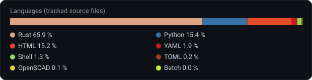

# roboterarm-hase-stats

Generated statistics for [HASE-HGV/Roboterarm-Hase](https://github.com/HASE-HGV/Roboterarm-Hase), served as plain files so the project README can embed them. There is no website and nothing to deploy.

A scheduled workflow regenerates the files daily from the original repository's git history.

## Endpoints

| File | Content |
|------|---------|
| [`summary.svg`](https://raw.githubusercontent.com/Catrick-cpu/roboterarm-hase-stats/main/summary.svg) | Stats card: commits, contributors, active days, last commit |
| [`languages.svg`](https://raw.githubusercontent.com/Catrick-cpu/roboterarm-hase-stats/main/languages.svg) | Language breakdown of tracked source files |
| [`stats.json`](https://raw.githubusercontent.com/Catrick-cpu/roboterarm-hase-stats/main/stats.json) | Raw numbers, including top contributors |

## Embed in a README

```markdown


```

## Regenerate locally

```bash
git clone https://github.com/HASE-HGV/Roboterarm-Hase.git source
python3 tools/stats.py --src source --out . --name HASE-HGV/Roboterarm-Hase
```

The script uses only the Python standard library.
